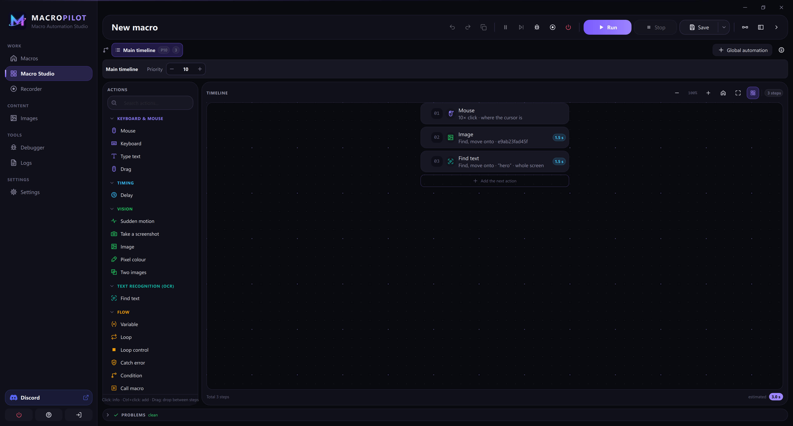
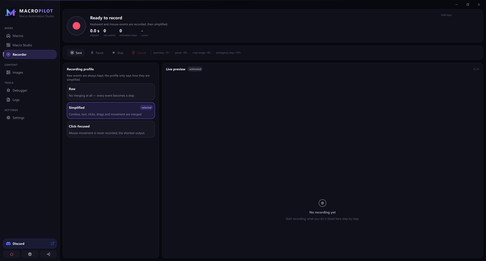
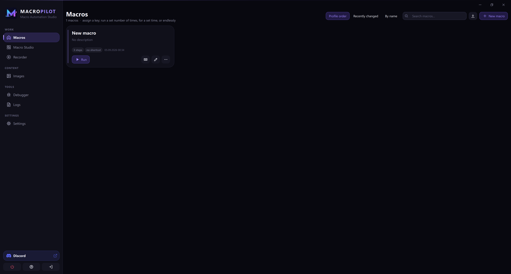
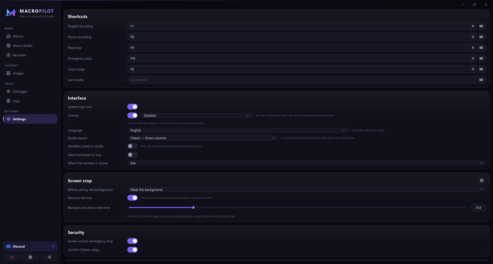
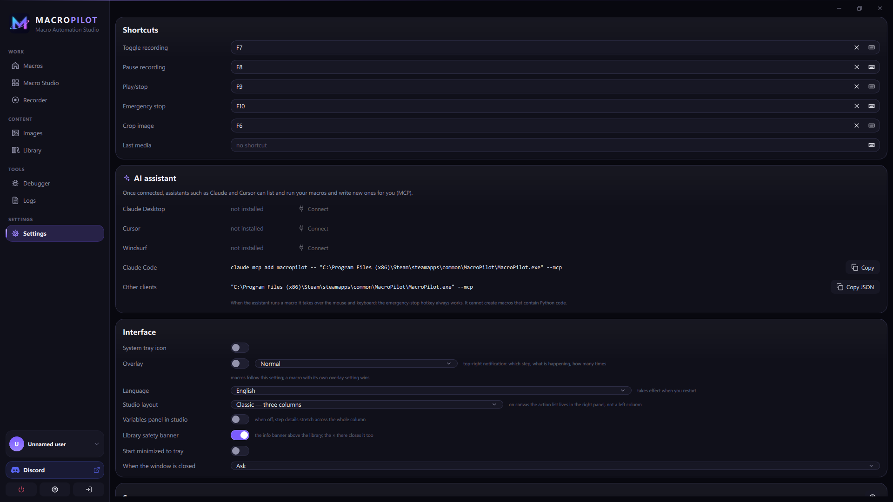

  

<h1 align="center">MacroPilot</h1>

  <b>A macro automation studio for Windows that can see your screen.</b> 
  Record once, edit it like a timeline, let it run.

  <a href="https://store.steampowered.com/app/5275200/MacroPilot/"><b>Get it on Steam</b></a> ·
  <a href="https://store.steampowered.com/app/5275200/MacroPilot/">Free demo</a> ·
  <a href="https://www.youtube.com/@MacroPiloty">Video tutorials</a> ·
  <a href="../../issues">Report a bug</a> ·
  <a href="../../discussions">Ask a question</a>

---

Most macro tools replay fixed coordinates. That works until a window moves,
the theme changes or the resolution is different, and then the macro clicks
empty space.

MacroPilot takes a different route. A step can find a button **by its
picture**, wait for a piece of **on-screen text**, or target a Windows control
**by its name**. When something moves, the macro still finds it.

> This repository holds the documentation, release notes and the public issue
> tracker for MacroPilot. MacroPilot itself is a closed-source app distributed
> through Steam; no source code is published here.

## Features

- **Recorder:** capture mouse and keyboard, including the real mouse path and
  how long each key was held, then simplify the recording into editable steps.
- **Macro Studio:** a visual timeline with loops, conditions, variables, error
  handling (`try` / `catch`) and sub-macros. No code required.
- **Image recognition:** multi-scale search that keeps working across
  resolutions and DPI settings.
- **Pixel and colour checks:** wait for a pixel to change, branch on a colour.
- **Text recognition (OCR):** find, wait for and click text on screen.
- **UI Automation:** target buttons, fields and menus of Windows apps by their
  accessible name instead of their position.
- **Global hotkeys, tray icon and an emergency stop** that works from anywhere.
- **Share macros as a single package.** Downloaded packages are verified before
  anything is written, and macros that run code cannot be shared.
- **Built-in MCP server:** AI assistants such as Claude or Cursor can list, run
  and write macros for you.
- **Plugins** and an optional Python script step for advanced users.
- **14 languages.** Fully offline, no account, no telemetry.

## Screenshots

| Macro Studio | Recorder |
|---|---|
|  |  |

| Macros | Settings | AI assistant |
|---|---|---|
|  |  |  |

## How it compares

|  | Coordinate recorders | Script tools | **MacroPilot** |
|---|---|---|---|
| Record and replay | ✓ | – | ✓ |
| Edit without writing code | – | – | ✓ |
| Find targets by image / text | – | with code | ✓ |
| Target Windows controls by name | – | with code | ✓ |
| Loops, conditions, variables | – | ✓ | ✓ |
| Survives a moved window or new resolution | – | depends | ✓ |

## Requirements

- Windows 10 or 11, 64-bit
- Steam (for installation and updates)

## Getting started

1. Install MacroPilot from [Steam](https://store.steampowered.com/app/5275200/MacroPilot/),
   or try the free demo first.
2. Press **Record**, do the task once, press **Stop**.
3. Open the recording in Macro Studio, replace fixed clicks with
   *Find image and click* where the layout may change.
4. Assign a hotkey and run it. The emergency stop hotkey halts any macro
   instantly.

## Support

- **Bug reports and feature requests:** [open an issue](../../issues/new).
  Please include your MacroPilot version (Settings > About), your Windows
  version and display scaling, and what you expected to happen.
- **Questions and macro ideas:** [Discussions](../../discussions).
- **Steam community:** [MacroPilot discussions on Steam](https://steamcommunity.com/app/5275200/discussions/).

Please use macros responsibly and follow the terms of any software or service
you automate.

## Release notes

| Version | Highlights |
|---|---|
| 1.0.5 | Clicks on MacroPilot's own window are no longer recorded; overlays are excluded from screen capture; menu overflow and translation fixes |
| 1.0.4 | Cursor return speed after playback: instant, fast or smooth |
| 1.0.3 | Keys the user is holding are not released at the end of a macro; option to return the cursor when finished |
| 1.0.2 | Recorded mouse paths, key hold durations, short pauses, bulk speed-up |

---

© MacroPilot. All rights reserved. Screenshots and documentation in this
repository may not be redistributed as part of another product.
